<picture>
  <source media="(max-width: 767px) and (prefers-color-scheme: dark)" srcset="assets/header-mobile-dark.svg">
  <source media="(max-width: 767px) and (prefers-color-scheme: light)" srcset="assets/header-mobile-light.svg">
  <source media="(prefers-color-scheme: dark)" srcset="assets/header-dark.svg">
  <source media="(prefers-color-scheme: light)" srcset="assets/header-light.svg">
  
</picture>

<a href="https://mohammad-sheykhi.vercel.app/">
<picture>
  <source media="(max-width: 767px) and (prefers-color-scheme: dark)" srcset="assets/contact-portfolio-mobile-dark.svg">
  <source media="(max-width: 767px) and (prefers-color-scheme: light)" srcset="assets/contact-portfolio-mobile-light.svg">
  <source media="(prefers-color-scheme: dark)" srcset="assets/contact-portfolio-dark.svg">
  <source media="(prefers-color-scheme: light)" srcset="assets/contact-portfolio-light.svg">
  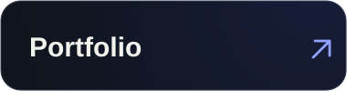
</picture>
</a>
<a href="https://www.linkedin.com/in/mohammad-sheykhi-a17aa4253/">
<picture>
  <source media="(max-width: 767px) and (prefers-color-scheme: dark)" srcset="assets/contact-linkedin-mobile-dark.svg">
  <source media="(max-width: 767px) and (prefers-color-scheme: light)" srcset="assets/contact-linkedin-mobile-light.svg">
  <source media="(prefers-color-scheme: dark)" srcset="assets/contact-linkedin-dark.svg">
  <source media="(prefers-color-scheme: light)" srcset="assets/contact-linkedin-light.svg">
  
</picture>
</a>
<a href="mailto:mmdbazooka@gmail.com">
<picture>
  <source media="(max-width: 767px) and (prefers-color-scheme: dark)" srcset="assets/contact-email-mobile-dark.svg">
  <source media="(max-width: 767px) and (prefers-color-scheme: light)" srcset="assets/contact-email-mobile-light.svg">
  <source media="(prefers-color-scheme: dark)" srcset="assets/contact-email-dark.svg">
  <source media="(prefers-color-scheme: light)" srcset="assets/contact-email-light.svg">
  
</picture>
</a>

<picture>
  <source media="(max-width: 767px) and (prefers-color-scheme: dark)" srcset="assets/intro-mobile-dark.svg">
  <source media="(max-width: 767px) and (prefers-color-scheme: light)" srcset="assets/intro-mobile-light.svg">
  <source media="(prefers-color-scheme: dark)" srcset="assets/intro-dark.svg">
  <source media="(prefers-color-scheme: light)" srcset="assets/intro-light.svg">
  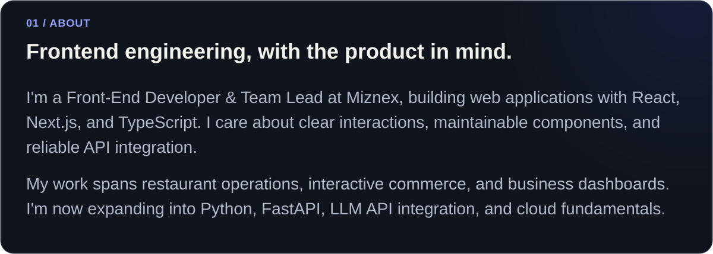
</picture>

<picture>
  <source media="(max-width: 767px) and (prefers-color-scheme: dark)" srcset="assets/selected-work-mobile-dark.svg">
  <source media="(max-width: 767px) and (prefers-color-scheme: light)" srcset="assets/selected-work-mobile-light.svg">
  <source media="(prefers-color-scheme: dark)" srcset="assets/selected-work-dark.svg">
  <source media="(prefers-color-scheme: light)" srcset="assets/selected-work-light.svg">
  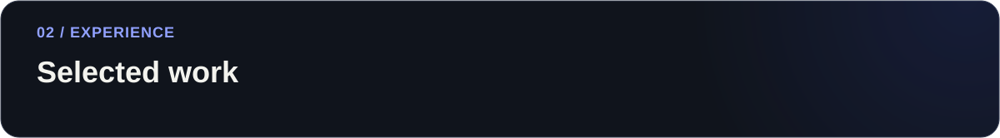
</picture>

<a href="https://miznex.com/">
<picture>
  <source media="(max-width: 767px) and (prefers-color-scheme: dark)" srcset="assets/miznex-mobile-dark.svg">
  <source media="(max-width: 767px) and (prefers-color-scheme: light)" srcset="assets/miznex-mobile-light.svg">
  <source media="(prefers-color-scheme: dark)" srcset="assets/miznex-dark.svg">
  <source media="(prefers-color-scheme: light)" srcset="assets/miznex-light.svg">
  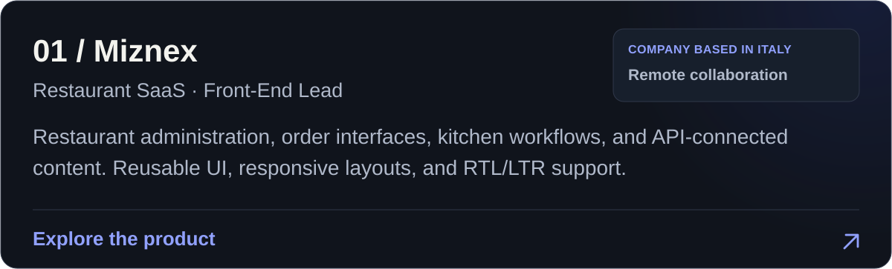
</picture>
</a>

<a href="https://hexorix.net/">
<picture>
  <source media="(max-width: 767px) and (prefers-color-scheme: dark)" srcset="assets/hexorix-mobile-dark.svg">
  <source media="(max-width: 767px) and (prefers-color-scheme: light)" srcset="assets/hexorix-mobile-light.svg">
  <source media="(prefers-color-scheme: dark)" srcset="assets/hexorix-dark.svg">
  <source media="(prefers-color-scheme: light)" srcset="assets/hexorix-light.svg">
  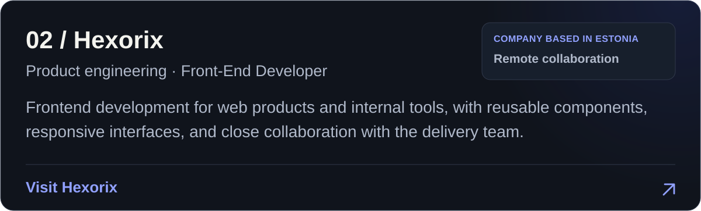
</picture>
</a>

<a href="https://karixo-work.vercel.app/">
<picture>
  <source media="(max-width: 767px) and (prefers-color-scheme: dark)" srcset="assets/karixo-mobile-dark.svg">
  <source media="(max-width: 767px) and (prefers-color-scheme: light)" srcset="assets/karixo-mobile-light.svg">
  <source media="(prefers-color-scheme: dark)" srcset="assets/karixo-dark.svg">
  <source media="(prefers-color-scheme: light)" srcset="assets/karixo-light.svg">
  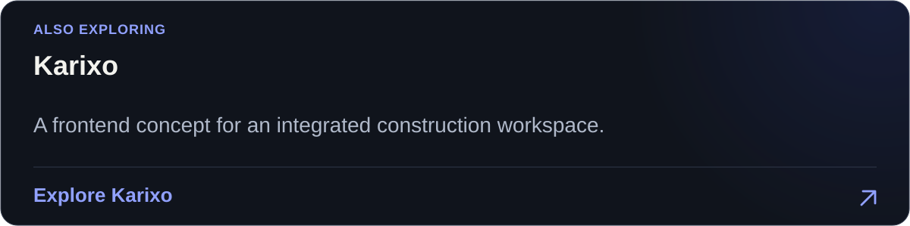
</picture>
</a>

<a href="https://mohammad-sheykhi.vercel.app/">
<picture>
  <source media="(max-width: 767px) and (prefers-color-scheme: dark)" srcset="assets/more-work-mobile-dark.svg">
  <source media="(max-width: 767px) and (prefers-color-scheme: light)" srcset="assets/more-work-mobile-light.svg">
  <source media="(prefers-color-scheme: dark)" srcset="assets/more-work-dark.svg">
  <source media="(prefers-color-scheme: light)" srcset="assets/more-work-light.svg">
  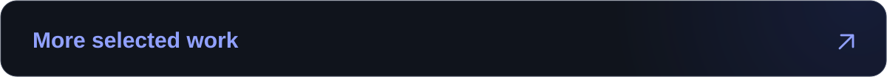
</picture>
</a>

<picture>
  <source media="(max-width: 767px) and (prefers-color-scheme: dark)" srcset="assets/tools-mobile-dark.svg">
  <source media="(max-width: 767px) and (prefers-color-scheme: light)" srcset="assets/tools-mobile-light.svg">
  <source media="(prefers-color-scheme: dark)" srcset="assets/tools-dark.svg">
  <source media="(prefers-color-scheme: light)" srcset="assets/tools-light.svg">
  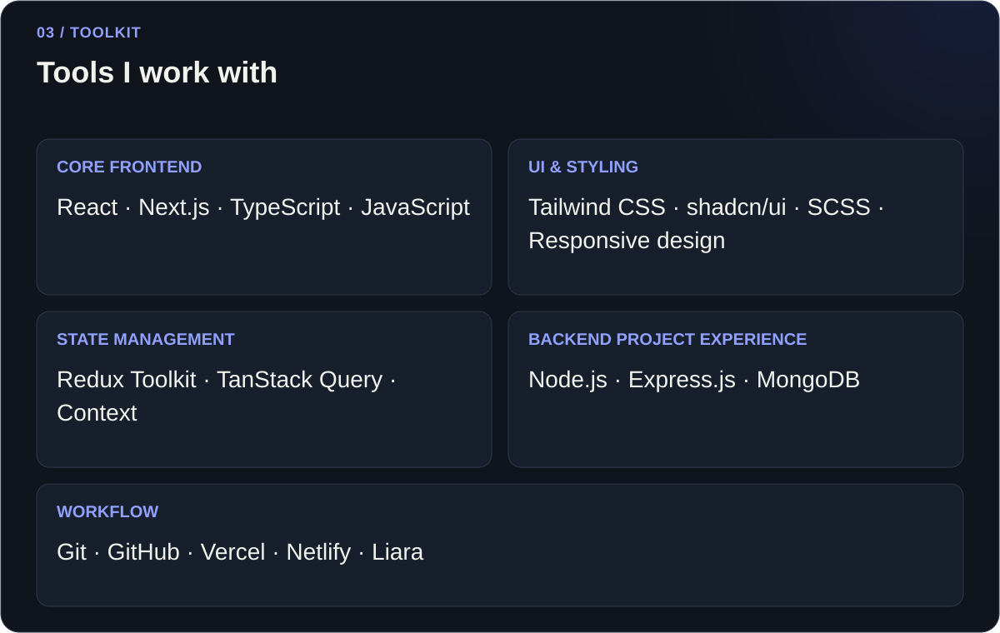
</picture>

<picture>
  <source media="(max-width: 767px) and (prefers-color-scheme: dark)" srcset="assets/learning-mobile-dark.svg">
  <source media="(max-width: 767px) and (prefers-color-scheme: light)" srcset="assets/learning-mobile-light.svg">
  <source media="(prefers-color-scheme: dark)" srcset="assets/learning-dark.svg">
  <source media="(prefers-color-scheme: light)" srcset="assets/learning-light.svg">
  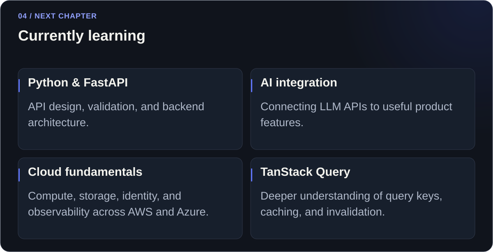
</picture>

<picture>
  <source media="(max-width: 767px) and (prefers-color-scheme: dark)" srcset="assets/approach-mobile-dark.svg">
  <source media="(max-width: 767px) and (prefers-color-scheme: light)" srcset="assets/approach-mobile-light.svg">
  <source media="(prefers-color-scheme: dark)" srcset="assets/approach-dark.svg">
  <source media="(prefers-color-scheme: light)" srcset="assets/approach-light.svg">
  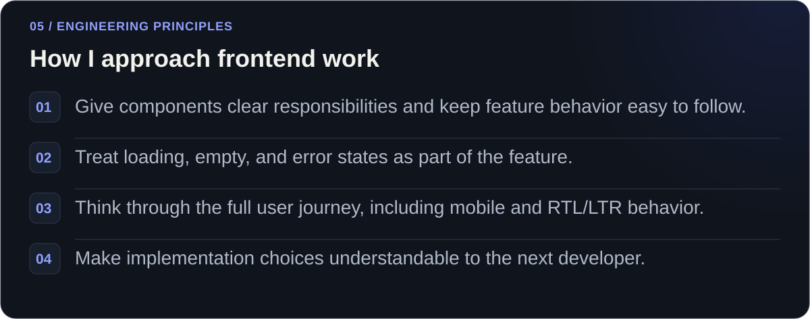
</picture>

<a href="mailto:mmdbazooka@gmail.com">
<picture>
  <source media="(max-width: 767px) and (prefers-color-scheme: dark)" srcset="assets/connect-mobile-dark.svg">
  <source media="(max-width: 767px) and (prefers-color-scheme: light)" srcset="assets/connect-mobile-light.svg">
  <source media="(prefers-color-scheme: dark)" srcset="assets/connect-dark.svg">
  <source media="(prefers-color-scheme: light)" srcset="assets/connect-light.svg">
  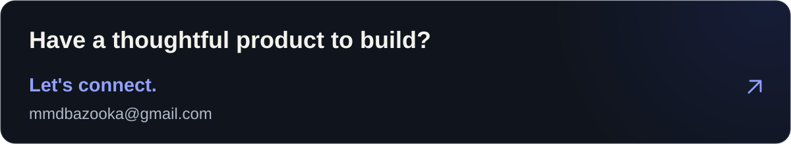
</picture>
</a>

<picture>
  <source media="(max-width: 767px) and (prefers-color-scheme: dark)" srcset="assets/footer-mobile-dark.svg">
  <source media="(max-width: 767px) and (prefers-color-scheme: light)" srcset="assets/footer-mobile-light.svg">
  
</picture>
