<picture>
  <source media="(prefers-color-scheme: dark)" srcset="assets/header-dark.svg">
  <source media="(prefers-color-scheme: light)" srcset="assets/header-light.svg">
  
</picture>

  <a href="https://mohammad-sheykhi.vercel.app/"><strong>Portfolio</strong></a> &nbsp; / &nbsp;
  <a href="https://www.linkedin.com/in/mohammad-sheykhi-a17aa4253/"><strong>LinkedIn</strong></a> &nbsp; / &nbsp;
  <a href="mailto:mmdbazooka@gmail.com"><strong>Email</strong></a>

### Frontend engineering, with the product in mind.

I'm a **Front-End Developer & Team Lead at [Miznex](https://miznex.com/)**, building web applications with **React, Next.js, and TypeScript**. I care about clear interactions, maintainable components, and reliable API integration.

My work spans restaurant operations, interactive commerce, and business dashboards. I'm now expanding into **Python, FastAPI, LLM API integration, and cloud fundamentals**.

### Selected work

<table>
  <tr>
    <td width="50%" valign="top">
      <h3>01 / Miznex</h3>
      
<strong>Restaurant SaaS · Front-End Lead</strong>

      
Company based in Italy · Remote collaboration

      
Restaurant administration, order interfaces, kitchen workflows, and API-connected content. Reusable UI, responsive layouts, and RTL/LTR support.

      
<a href="https://miznex.com/">Explore the product ↗</a>

    </td>
    <td width="50%" valign="top">
      <h3>02 / Hexorix</h3>
      
<strong>Product engineering · Front-End Developer</strong>

      
Company based in Estonia · Remote collaboration

      
Frontend development for web products and internal tools, with reusable components, responsive interfaces, and close collaboration with the delivery team.

      
<a href="https://hexorix.net/">Visit Hexorix ↗</a>

    </td>
  </tr>
</table>

**Also exploring:** [Karixo](https://karixo-work.vercel.app/), a frontend concept for an integrated construction workspace. [More selected work →](https://mohammad-sheykhi.vercel.app/)

### Tools I work with

| Area | Technologies |
| :--- | :--- |
| Core frontend | React · Next.js · TypeScript · JavaScript |
| UI & styling | Tailwind CSS · Shadcn/ui · SCSS · Responsive design |
| State managment | Redux Toolkit · TanStack Query · Context |
| Backend project experience | Node.js · Express.js · MongoDB |
| Workflow | Git · GitHub · Vercel · Netlify · Liara |

### Currently learning

- **Python & FastAPI:** API design, validation, and backend architecture.
- **AI integration:** connecting LLM APIs to useful product features.
- **Cloud fundamentals:** compute, storage, identity, and observability across AWS and Azure.
- **TanStack Query:** deeper understanding of query keys, caching, and invalidation.

### How I approach frontend work

- Give components clear responsibilities and keep feature behavior easy to follow.
- Treat loading, empty, and error states as part of the feature.
- Think through the full user journey, including mobile and RTL/LTR behavior.
- Make implementation choices understandable to the next developer.

---

**Have a thoughtful product to build?** [Let's connect.](mailto:mmdbazooka@gmail.com)

